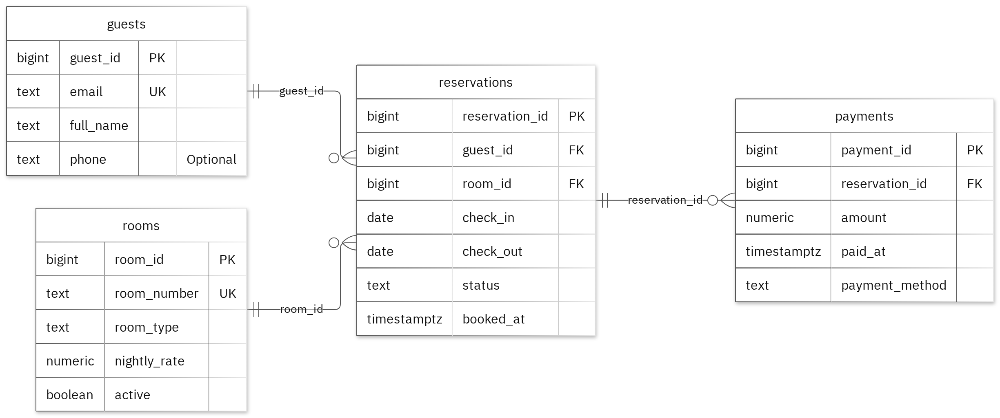

# MIT 8103 Advanced Database Systems

**Hotel Reservation System** · Adebisi Onabanjo · Student ID 301835755

## Case study

My case study is a Hotel Reservation System. I designed the database so front-desk staff can manage guest details and reservations, and managers can review room occupancy and payment summaries. The data sits in separate tables named guests, rooms, reservations and payments.

The database supports these operations:

   Creating and retrieving guests, rooms, reservations and payments.
   Finding active rooms available for a requested date range.
   Summarizing collected payments by room type and month.

I also planned a separate benchmark. It generates 20,000 synthetic reservations and compares the same booked_at date-range filter with and without a B-tree index. I record what I measure and don’t assume which plan will be faster.

## Portfolio 1: Database Design and Modelling

I organised the relational design into 4 tables. Primary keys identify records, foreign keys preserve the links, and checks enforce the stated business rules. At most one confirmed reservation per room may have a given check-in date; enforce with a partial unique key on room_id and check_in for confirmed rows. The normalisation examples show the sample data at 1NF, 2NF and 3NF. All 32 deliberately invalid inserts were rejected without changing the valid sample rows.

Figure 1. Tables, keys and relationships. PK: primary key; FK: foreign key; UK: unique value.

<!-- PAGE BREAK -->

## Portfolio 2: Query Processing and Optimisation

I ran three SQL queries against the sample records. The join returned 2 rows and included alex.river@example.test with 101. For the index comparison, I used 20,000 separate performance rows. The median lookup time changed from 1.017 ms to 0.173 ms. Both phases returned the same records. The measured plan used the new index. These timings apply to this lookup and environment.

## Portfolio 3: Transactions and Concurrency

I used a temporary counter on reservations to test COMMIT, ROLLBACK and READ COMMITTED isolation. The uncommitted update remained hidden from the other session, and ROLLBACK restored the earlier committed value. Without locking, two increments left the counter at 2. With SELECT FOR UPDATE, Session B waited for Session A and the final value was 3. The helper is confined to this exercise; the case's original business fields stay unchanged.

## Portfolio 4: NoSQL and Advanced Data Models

I used reservation_events for the case's event documents. MongoDB inserted 4 sample events and returned the expected results for 4 queries. Validation rejected an invalid date type and a duplicate event ID. Embedded snapshots keep related details with an event, while the details field can differ by event type. These are fictional events; PostgreSQL continues to enforce its relational rules.

## Repository and evidence

https://github.com/aonabanjo5755-sys/Onabanjo_Adebisi_301835755

The portfolio folders contain the SQL and JavaScript, explanations, query plans, result tables and screenshots.

<!-- PAGE BREAK -->

## Portfolio 5: Distributed and Cloud Database Exercise

I proposed three MongoDB replica members across separate failure zones. The discussion covers primary elections, majority acknowledgement, secondary lag and sharding trade-offs for reservation_events. Replication supports availability, while backups address recovery. PostgreSQL needs its own availability plan. This is the permitted discussion option; no live replica set or failover test was deployed.

## Individual reflection

I kept guests, rooms, reservations and payments in separate tables so their details can be maintained without repeating them in every related record. At most one confirmed reservation per room can have a given check-in date, and I enforce this with a partial unique key on room_id and check_in for confirmed rows. The constraint tests check this along with the required values and record links.

The two-session exercise showed me that both sessions can read the same value before either update is committed. Locking the row before reading keeps both increments. The index comparison also taught me to check the execution plan as well as the final answer, because the same result can take very different amounts of database work.

## AI-use declaration

I used GitHub Copilot and the portfolio generator to help prepare the database model, scripts and explanations. The generator ran the PostgreSQL and MongoDB exercises, checked their outputs and captured the result images.  I remain responsible for checking and explaining the submitted work.

## References

- [PostgreSQL: constraints](https://www.postgresql.org/docs/17/ddl-constraints.html)
- [PostgreSQL: EXPLAIN](https://www.postgresql.org/docs/17/using-explain.html)
- [PostgreSQL: isolation](https://www.postgresql.org/docs/17/transaction-iso.html)
- [PostgreSQL: row locks](https://www.postgresql.org/docs/17/explicit-locking.html)
- [MongoDB: data modelling](https://www.mongodb.com/docs/manual/data-modeling/)
- [MongoDB: replication](https://www.mongodb.com/docs/manual/replication/)
- [MongoDB: sharding](https://www.mongodb.com/docs/manual/sharding/)
- [Mermaid: ER diagrams](https://mermaid.js.org/syntax/entityRelationshipDiagram.html)

